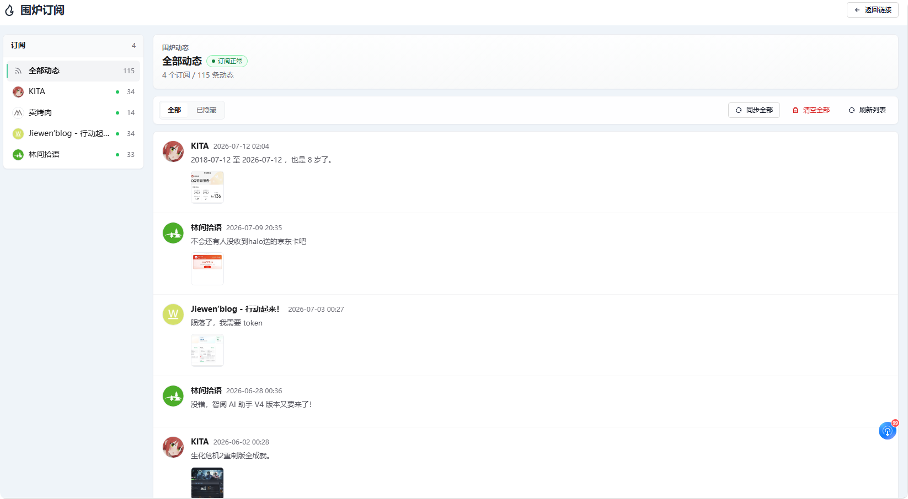

# 围炉 halo-plugin-fireside

聚合友链博主的说说、动态、瞬间，与你自己的瞬间混排成一条朋友圈式时间线，像刷朋友圈一样看到朋友们的近况。

站长在**链接插件**中为友链填写一个"动态 RSS 地址"，本插件定时抓取这些 RSS，把友链博主的动态存下来，并将其与你自己的**瞬间**合并成统一时间线。插件自带内置页面 `/fireside`，安装后直接访问即可看到朋友圈式时间线；也提供 Finder 接口供主题深度定制。

> 与文章类 RSS 聚合插件的定位不同：它们聚合友链的**文章**（标题 + 摘要的阅读列表），围炉聚合的是友链的**动态**（说说/瞬间的全文与配图）——把生活和文章分开，文章认真读，生活轻松刷。

**在线演示**：[演示地址](https://blog.timxs.com/fireside)



## 特性

- **零侵入**：不修改链接插件与瞬间插件，通过 AnnotationSetting 向链接编辑表单注入"动态 RSS 地址"字段；
- **语义无关**：填什么 RSS 就聚合什么（瞬间、文章均可），未填写的友链完全不受影响；
- **数据隔离**：友链条目存独立模型 `FriendMoment`，不污染自己的瞬间数据；
- **实时混排**：自己的瞬间实时直读（发布后刷新即见），友链条目由定时同步落库（请求路径零远程 HTTP），作者昵称/头像等展示信息实时跟随链接插件中的友链设置；
- **安全**：外部 HTML 经 jsoup 白名单清洗（防 XSS）、图片/链接绝对化、SSRF 内网地址防护、未来时间戳钳制；
- **自动清理**：同一友链内按 `postLink` 去重、每友链保留最新 N 条、友链删除或取消订阅时级联清理；
- **Console 管理页**：左侧订阅列表（同步状态徽章）+ 动态条目流，支持手动同步（单个/全部）、暂停订阅（不删数据）、隐藏/恢复条目（隐藏后不对外展示且不会被重新抓取）、清空数据；
- **内置朋友圈页面**：自带 `/fireside` 页面，仿微信朋友圈样式（封面图 + 个人签名 + 时间线列表），每页均为服务端渲染 + 游标分页，自身瞬间支持点赞与评论（列表卡片下方仿朋友圈灰底就地预览最新评论），登录后可在页面内直接发瞬间（仿朋友圈发表页），支持 `?tag=` 按标签过滤（如 `?tag=友链` 只看朋友），模板可被主题覆盖；
- **音乐/视频/网页分享卡**：正文中的网易云、QQ 音乐、酷狗、B 站、抖音、YouTube、腾讯视频分享链接渲染为音乐/视频卡，其余独立成段的网页链接渲染为通用分享卡（仿微信朋友圈）；建议安装 [编辑器超链接卡片](https://www.halo.run/store/apps/app-UpUJA) 以自动补全标题与封面（前台调用其 `link-detail`），未安装时显示可点击的占位卡；
- **公开时间线 API**：匿名 JSON 接口，供主题 JS 或第三方前端自定义加载。

## 环境要求

- Halo `>= 2.25.0`
- [链接插件 PluginLinks](https://github.com/halo-sigs/plugin-links)（必需）
- [瞬间插件 PluginMoments](https://github.com/halo-sigs/plugin-moments) `>= 1.16.0`（可选：未安装时时间线只含友链条目）
- [编辑器超链接卡片](https://github.com/halo-sigs/plugin-editor-hyperlink-card)（可选：为分享卡补全标题与封面；未安装时仅占位壳）

## 使用

1. 下载 `plugin-fireside-x.x.x.jar`，在 Console「插件」页上传安装并启用；
2. 在 Console「链接」中编辑某个友链，元数据区填写**动态 RSS 地址**（如对方为 Halo 且装有瞬间 + RSS 插件，一般为 `https://对方域名/feed/moments/rss.xml`；普通文章 RSS 也可以）；勾选**暂停同步**可临时停抓且保留已有数据；
3. 等待定时同步（默认每 60 分钟，可在插件设置中调整），或在 Console「围炉」管理页点击**同步全部**立即抓取；
4. 访问 `/fireside` 查看混排时间线，支持 `?tag=友链`（标签名与插件设置一致）只看朋友动态。

### 内置页面

插件自带 `/fireside` 页面，无需主题适配即可使用：

- **首屏服务端渲染**（SSR），每页条数可在设置中调整（默认 20）；分页为游标式"更早的动态"，任意翻页深度成本恒定，无条数上限；
- 标签导航单行横向滑动（全部 + 各标签含条数，本地标签按条数降序、友链标签固定末位）；
- 卡片展示：头像、昵称、正文、图片（单图原比例 / 4 图田字格 / 其余三列网格）、音乐/视频/网页分享卡（占位 + 可选 `link-detail` 补全）、时间、标签、友链"查看原文"外链；
- 顶部仿朋友圈封面：封面图与签名在插件设置中配置，昵称与头像取自站点标题和站点 Logo；
- 自身瞬间支持互动：点赞（走 Halo 计数接口，与主题页点赞记录互通）、评论预览（卡片下方仿朋友圈灰底块，进入视口后经 Halo 公开评论接口加载最新顶层评论并按时间正序展示，置顶评论优先入选；条数可在设置中调整，超出显示「查看全部 N 条评论」）、复制详情页链接；点击评论按钮或预览块进入详情页评论区（官方 `halo:comment` 组件，未装「评论组件」插件时优雅降级）；友链条目展示"查看原文"外链；
- 自身瞬间有内置详情页 `/fireside/{name}`（时间戳点入），单条全文 + 点赞 + 评论区默认展开；可见性与瞬间插件原生行为一致（匿名仅见已通过的公开瞬间）；
- **页面内发瞬间**（需瞬间插件）：封面右上角相机入口，仅对已登录且有「允许发布自己的瞬间」权限的用户显示（可在设置中关闭）。仿微信发表页：正文 `#标签 ` 打空格生效、带官方同款标签联想；图片可点 + 选择，桌面也可直接拖文件进卡片，选后仅本地预览，长按（移动端）/按住（桌面）拖拽调整顺序；点「发表」才按九宫格顺序逐张上传，失败标红、重按发表只补传失败的；可切换公开/私密，无免审核权限的用户发布后需经后台审核才会展示；
- 配色方案可在设置中指定默认值（跟随系统 / 浅色 / 深色），并默认在右下角提供访客切换按钮（选择记忆在访客浏览器本地，可在设置中关闭）；移动端自适应；封面左上角返回首页、滚动后右下角返回顶部、底部版权页脚；
- 主题可在 `templates/fireside.html` 放同名模板覆盖内置页面（深度定制时使用）。

### 管理端 API

手动同步与清空（子资源动作，需管理权限；两者互斥，冲突时返回 409）：

```
POST /apis/console.api.fireside.timxs.com/v1alpha1/links/{name}/sync            # 同步，name 为链接名，- 表示全量
POST /apis/console.api.fireside.timxs.com/v1alpha1/links/{name}/clear-moments   # 清空已抓取动态，- 表示全部
```

### 公开时间线 API（匿名）

```
GET /apis/api.fireside.timxs.com/v1alpha1/timeline?size=10&tag=&before=
```

与内置 `/fireside` 相同的**游标分页**（`firesideFinder.timelineSlice`）：`before` 为空为第一页，下一页传上一页返回的 `nextCursor`；`size` 默认 10、上限 50。任意翻页深度成本恒定。**仅支持游标，无 `page` 参数。** `nextCursor` 含 `|` 与 `:`，写入查询串前必须 URL 编码（`URLSearchParams` / `encodeURIComponent`），否则浏览器/网关可能直接 400。

响应结构：

```jsonc
{
  "items": [
    {
      "external": true,               // true=友链条目，false=自身瞬间
      "sourceUrl": "https://…",       // 原文链接（自身瞬间为 /moments/{name}）
      "authorUrl": "https://…",       // 友链作者站点（自身瞬间为 null）
      "title": "条目标题或 null",
      "owner": { "displayName": "作者", "avatar": "…", "name": "…" },
      "spec": {
        "releaseTime": "2026-07-14T03:00:00Z",
        "tags": ["友链"],
        "content": {
          "html": "<p>已清洗的正文 HTML</p>",
          "medium": [ { "type": "PHOTO", "url": "https://…" } ]
        }
      },
      "stats": { "upvote": 0, "totalComment": 0 }
    }
  ],
  "hasNext": true,          // 是否还有更早的动态——无限滚动的终止判断
  "nextCursor": "2026-07-14T03:00:00Z|f|friend-moment-xxx"  // 有下一页时非空；作 ?before= 前须编码
}
```

主题侧无限滚动的最小骨架（触底加载更早一页）。**注意**：只有 `content.html`（友链侧已经过服务端白名单清洗）可作 HTML 插入；昵称、头像 URL、外链等须走文本节点或属性赋值，勿拼进 `innerHTML`：

```html
<div id="fs-timeline"></div>
<button id="fs-more">加载更多</button>
<script>
  let before = '', loading = false;
  const list = document.getElementById('fs-timeline');
  const more = document.getElementById('fs-more');

  function text(s) {
    return document.createTextNode(s == null ? '' : String(s));
  }

  async function loadMore() {
    if (loading) return;
    loading = true;
    const qs = new URLSearchParams({ size: '10' });
    if (before) qs.set('before', before);
    const res = await fetch('/apis/api.fireside.timxs.com/v1alpha1/timeline?' + qs);
    const data = await res.json();
    for (const m of data.items || []) {
      const item = document.createElement('article');
      const header = document.createElement('header');
      if (m.owner && m.owner.avatar) {
        const img = document.createElement('img');
        img.src = m.owner.avatar;
        img.alt = '';
        img.referrerPolicy = 'strict-origin-when-cross-origin';
        header.appendChild(img);
      }
      const name = document.createElement('span');
      name.appendChild(text(m.owner && m.owner.displayName));
      header.appendChild(name);
      const time = document.createElement('time');
      time.appendChild(text(m.spec && m.spec.releaseTime
        ? new Date(m.spec.releaseTime).toLocaleString() : ''));
      header.appendChild(time);
      item.appendChild(header);
      const content = document.createElement('div');
      content.className = 'content';
      // 仅友链/自身经服务端处理的 html 可信任为 HTML
      content.innerHTML = (m.spec && m.spec.content && m.spec.content.html) || '';
      item.appendChild(content);
      if (m.external && m.sourceUrl) {
        const a = document.createElement('a');
        a.href = m.sourceUrl;
        a.target = '_blank';
        a.rel = 'noreferrer';
        a.appendChild(text('查看原文'));
        item.appendChild(a);
      }
      list.appendChild(item);
    }
    before = data.nextCursor || '';
    loading = false;
    if (!data.hasNext) more.remove();
  }

  more.addEventListener('click', loadMore);
  loadMore();
</script>
```

把按钮点击换成 `IntersectionObserver` 监听底部哨兵元素即可变成真正的触底自动加载；需要"只看朋友"时给请求加 `&tag=友链`（与插件设置中的友链动态标签一致）。

### 插件设置

**展示设置（display 组）**

| 设置项 | 默认 | 说明 |
|---|---|---|
| 页面标题 | 围炉 | 内置 `/fireside` 页面的标题 |
| 详情页标题 | 无 | 详情页顶栏与浏览器标题使用的名称，留空则跟随页面标题 |
| 标题分隔符 | `-` | 浏览器标签页标题的分隔符，可选 `-` 或 `\|` |
| 每页条数 | 20 | 内置页每页展示的动态条数，范围 10~100 |
| 友链动态标签 | 友链 | 赋给每条友链动态的标签（`spec.tags`）；可用 `?tag=该标签` 仅筛出友链动态 |

「外观」分节（`display.appearance`）：

| 设置项 | 默认 | 说明 |
|---|---|---|
| 封面图 | 无 | 内置页面顶部的朋友圈式封面图，留空则使用默认深色底 |
| 签名 | 无 | 显示在封面下方、头像一侧（仿朋友圈签名位），可填站点一句话描述，留空则不显示 |
| 配色方案 | 跟随系统 | 内置页默认配色（跟随系统 / 浅色 / 深色）；允许访客切换时，访客的选择优先 |
| 允许访客切换配色 | 开 | 右下角 明/暗/自动 切换按钮，访客选择保存在其浏览器本地；关闭后严格按默认配色显示 |

「互动」分节（`display.interaction`）：

| 设置项 | 默认 | 说明 |
|---|---|---|
| 评论预览条数 | 10 | 自身瞬间卡片下方灰底展示的最新顶层评论条数（不含回复）；0 关闭预览，-1 全部显示，超出时显示「查看全部 N 条评论」入口 |
| 显示发瞬间入口 | 开 | 封面右上角相机按钮，仅对已登录且有「允许发布自己的瞬间」权限的用户可见 |

**同步设置（sync 组）**

| 设置项 | 默认 | 说明 |
|---|---|---|
| 启用定时同步 | 开 | 总开关 |
| 同步间隔（分钟） | 60 | 到期判断 |
| 每轮最多处理的友链数 | 20 | |
| 每个友链保留的最新条数 | 20 | 超出删最旧 |
| 抓取超时（秒） | 10 | |

## 主题接入（可选）

插件自带内置页面 `/fireside` 开箱即用。如需将混排时间线集成到主题的 `/moments` 页面，在主题 `templates/moments.html` 中，给包住"列表循环 + 分页"的容器元素加一个 `th:with`，用聚合结果覆盖 `moments` 变量即可——容器内原有的循环、字段访问、分页代码**原样不动**：

```html
<div th:with="moments=${firesideFinder.timeline(moments.page, moments.size)}">
  <!-- 主题原有渲染代码（th:each="moment : ${moments.items}"、
       moment.spec.content.html、moment.owner.displayName、moments.nextUrl 分页等）全部照旧 -->
</div>
```

若主题瞬间页支持 `?tag=` 过滤，使用重载 `firesideFinder.timeline(moments.page, moments.size, param.tag)`。tag 的行为：

- tag 为空：自身瞬间 + 友链动态混排；
- tag 等于设置中的**友链动态标签**（默认"友链"）：仅返回友链动态——主题可直接渲染一个指向 `/moments?tag=友链` 的入口实现"只看朋友"；
- tag 为其它值：仅返回自身瞬间（按本站标签过滤）。

每条友链动态的 `spec.tags` 会携带该标签，主题渲染标签链接时点击即可筛选。

### 可选增强

友链条目带扩展字段，可加来源标识：

```html
<span th:if="${moment.external}" class="fireside-badge">
  来自 <a th:href="${moment.authorUrl}" th:text="${moment.owner.displayName}"></a>
  · <a th:href="${moment.sourceUrl}" referrerpolicy="no-referrer" target="_blank">原文</a>
</span>
```

主题也可在任意位置调用 `firesideFinder.listFriends(page, size)` 或 `firesideFinder.listFriends(page, size, linkName)` 单独展示友链动态区块。

### Finder API

| 方法 | 返回 | 说明 |
|---|---|---|
| `firesideFinder.timeline(page, size)` | `UrlContextListResult<FiresideMomentVo>` | 混排时间线，形状与瞬间插件 `moments` 变量一致（items/total/hasNext/prevUrl/nextUrl 全齐，页数按混排后 total 计算） |
| `firesideFinder.timeline(page, size, tag)` | 同上 | tag 过滤重载 |
| `firesideFinder.listFriends(page, size[, linkName])` | `ListResult<FiresideMomentVo>` | 仅友链条目 |

`FiresideMomentVo` 字段路径与瞬间插件 `MomentVo` 兼容，另附加：`external`（是否友链条目）、`sourceUrl`（原文链接）、`authorUrl`（作者站点）、`title`（RSS 条目标题，可空）。

### 富链接（音乐 / 视频 / 网页分享卡）

服务端在清洗后的 `content.html` 中把「像分享主链」的链接（块内几乎只有该链接）替换为占位结构（`div.fireside-rich-link`，含默认封面与平台名/主机名），并**固定为正文在上、分享卡在下**（仿微信朋友圈）。内置页 `fireside.js` 在卡片进入视口后请求：

```http
GET /apis/api.hyperlink.halo.run/v1alpha1/link-detail?url={encodeURIComponent(href)}
```

（由可选依赖「编辑器超链接卡片」提供，匿名可读。）成功则写入标题/封面；失败或未装插件则保持占位，不影响点击跳转。

| 链接 | 卡片类型 |
|---|---|
| 网易云音乐、QQ 音乐、酷狗 | 音乐卡 |
| B 站、抖音、YouTube、腾讯视频 | 视频卡 |
| 其余独立成段的 http(s) 链接 | 通用网页卡（副标题显示主机名） |

- **自身瞬间**：Finder 组装展示时注入占位（不写回瞬间存储），刷新围炉页即可。
- **友链条目**：仅在 RSS **同步入库**时写入占位；列表/公开 API **读路径不再做富链接解析**（避免每条 Jsoup）。
- 主题若自渲染 `content.html`，可复用类名 `.fireside-rich-link` 或引入围炉静态脚本中的填充逻辑。

### 已知限制

- 友链条目无详情页：点击"查看原文"跳转至友链站点（自身瞬间的内置详情页为 `/fireside/{name}`）；
- `stats` 恒为 0：友链条目没有本站点赞/评论数据；
- `owner.name` 是 linkName：主题若用它拼作者页链接，友链条目的链接无效；
- 主题接入模式下：主题若用 `metadata.name` 拼 `/moments/{name}` 详情链接，友链条目点入会 404——用 `moment.external` 判断改链 `moment.sourceUrl`；
- 富链接真封面依赖可选的「编辑器超链接卡片」；短链（如 `b23.tv`）不解析跳转，仅识别平台；句中内联链接不会升级为大卡；
- 友链富链接占位在同步入库时写入，不随页面阅读重算。

## 开发

```bash
# 构建（需 JDK 21）
./gradlew build

# 本地开发（需 Docker）
./gradlew haloServer
```

构建完成后，插件 jar 位于 `build/libs`。

## 许可证

[GPL-3.0](./LICENSE) © Tim0x0
